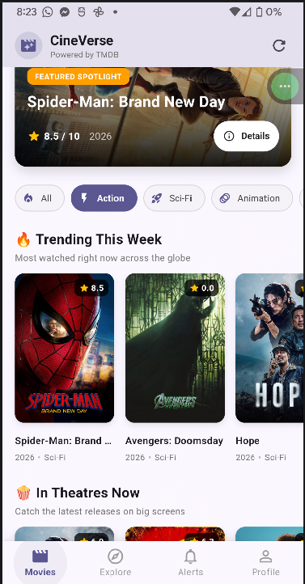
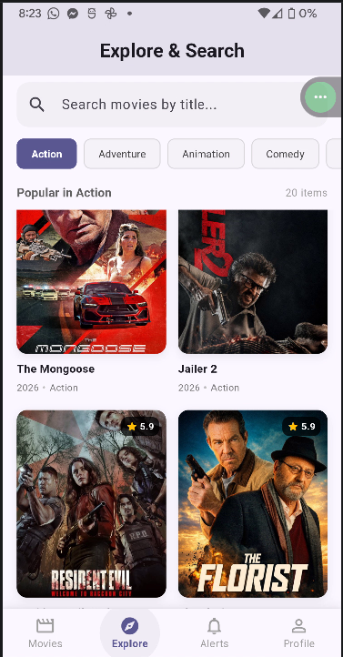
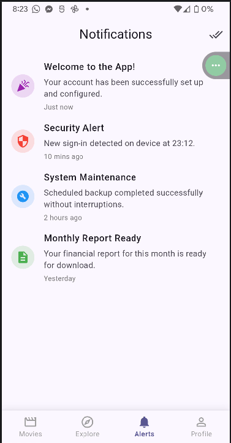

# CineVerse

CineVerse is a modern movie discovery and exploration mobile application built with Flutter and powered by The Movie Database (TMDB) API. The application provides users with real-time access to trending titles, theatrical releases, all-time classics, detailed movie metadata, and an interactive discovery search interface.

---

## App Previews

| Movies & Spotlight | Explore & Search | Alerts & Notifications |
| :---: | :---: | :---: |
|  |  |  |

---

## Key Features

- **Spotlight Banner**: Highlights the top trending title with backdrop imagery, rating metrics, release year, and quick access to details.
- **Dynamic Genre Filtering**: Instant categorization across genres such as Action, Sci-Fi, Animation, Comedy, Horror, and Drama.
- **Curated Movie Sections**: Horizontal carousels showcasing Weekly Trending, In Theatres Now, and All-Time Top Rated films.
- **Live Search**: Debounced real-time movie search engine enabling fast filtering by title and keyword.
- **Comprehensive Details Screen**: Deep-dive pages displaying storyline overviews, ratings, release metadata, cast rosters, and similar movie recommendations.
- **Secure Configuration**: API tokens and keys are decoupled from the code base using environment configuration files.
- **Graceful Loading & Error States**: Network resilience with adaptive progress indicators and fallbacks for missing assets.

---

## Tech Stack

- **Framework**: Flutter (Material 3)
- **Language**: Dart
- **Networking**: `http` package
- **Configuration**: `flutter_dotenv` for environment variable management
- **Data Source**: TMDB (The Movie Database) REST API v3

---

## Project Structure

```text
lib/
├── config/
│   └── tmdb_config.dart          # TMDB endpoints, headers, and genre mappings
├── models/
│   └── movie_model.dart          # Movie, MovieDetail, and CastMember data models
├── screens/
│   ├── login_screen.dart         # Authentication screen
│   ├── register_screen.dart      # User registration screen
│   ├── main_navigation_screen.dart # Bottom navigation bar controller
│   ├── movie_detail_screen.dart  # Detailed movie view with cast and suggestions
│   └── tabs/
│       ├── home_tab.dart         # Main movie dashboard and category carousels
│       ├── explore_tab.dart      # Real-time search and genre explorer
│       ├── notifications_tab.dart# User notifications and activity alerts
│       └── profile_tab.dart      # User account settings
└── services/
    └── tmdb_service.dart         # HTTP service client for TMDB endpoints
```

---

## Getting Started

### Prerequisites

Ensure you have the following installed on your development workstation:

- Flutter SDK (version 3.0.0 or higher)
- Dart SDK
- Android Studio / Xcode (for mobile emulators or physical device deployment)
- A TMDB account to obtain an API Key / Read Access Token

### Installation

1. **Clone the repository:**
   ```bash
   git clone https://github.com/your-username/cineverse.git
   cd cineverse
   ```

2. **Install project dependencies:**
   ```bash
   flutter pub get
   ```

3. **Configure Environment Variables:**
   Create a `.env` file in the root directory by duplicating `.env.example`:
   ```bash
   cp .env.example .env
   ```

   Open `.env` and enter your TMDB credentials:
   ```env
   TMDB_API_KEY=your_actual_tmdb_api_key_here
   TMDB_READ_ACCESS_TOKEN=your_actual_tmdb_read_access_token_here
   ```

4. **Run the application:**
   ```bash
   flutter run
   ```

---

## Building the APK

To generate a standalone Android APK:

- **Debug build:**
  ```bash
  flutter build apk --debug
  ```

- **Release build:**
  ```bash
  flutter build apk --release
  ```

The generated file will be located at:
`build/app/outputs/flutter-apk/app-release.apk`

---

## Environment Variables Reference

| Variable | Required | Description |
| :--- | :--- | :--- |
| `TMDB_API_KEY` | Yes | The TMDB v3 API Key for client requests |
| `TMDB_READ_ACCESS_TOKEN` | Yes | Bearer Token for authorized TMDB v4/v3 headers |

---

## License

This project is licensed under the MIT License - see the LICENSE file for details.
